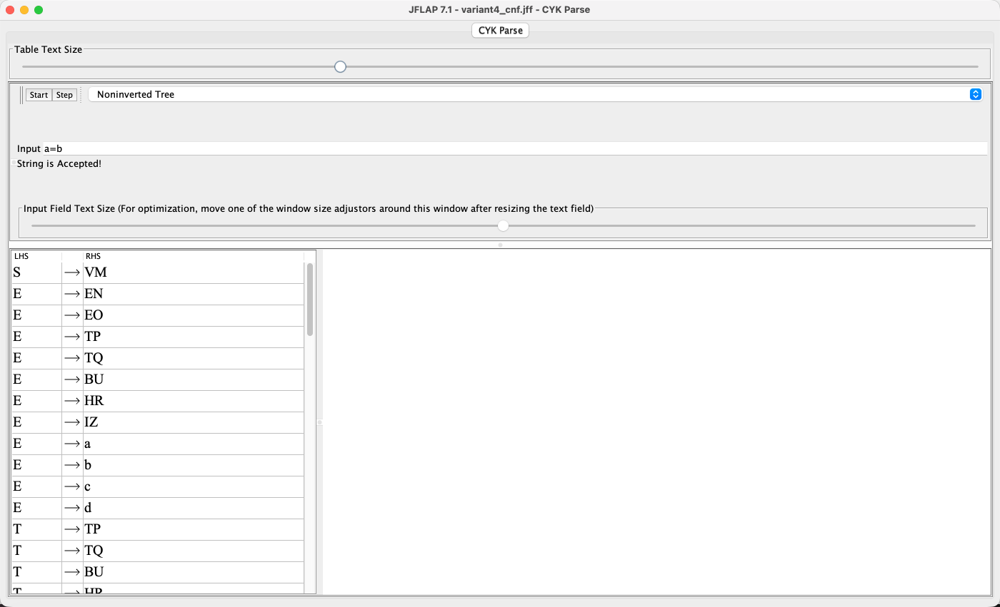
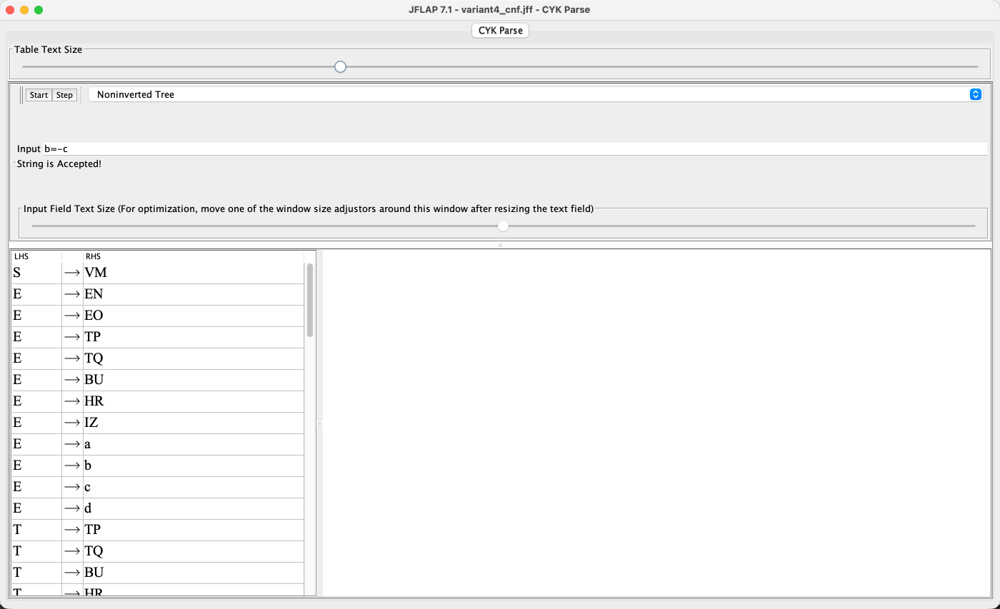
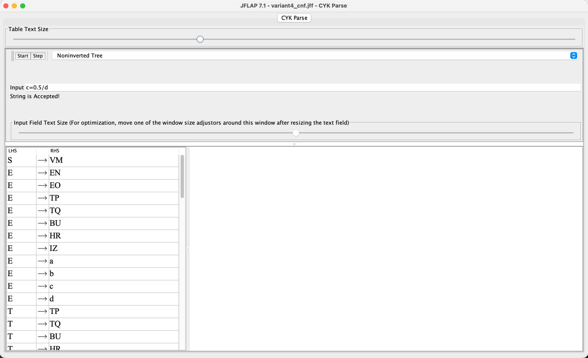
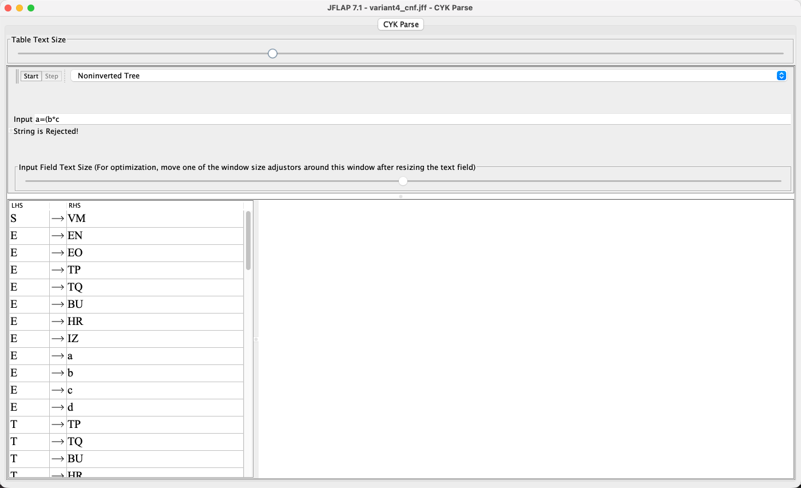

# 4. Перехваты экранов распознавания тестовых цепочек методом Кока-Янгера-Касами

Итоговая НФХ-грамматика проверена в штатном окне `CYK Parse` системы JFLAP 7.1. На каждом снимке интерфейса видны введенная цепочка, сообщение JFLAP `String is Accepted!` или `String is Rejected!` и таблица продукций. В таблице ниже приведены семь корректных и пять некорректных цепочек.

| № | Цепочка | Результат | Обоснование |
|---:|---|:---:|---|
| 1 | `a=b` | Accept | допустимые переменные и присваивание |
| 2 | `b=-c` | Accept | допустимый унарный минус |
| 3 | `c=a+b` | Accept | сложение переменных |
| 4 | `d=a*b` | Accept | умножение переменных |
| 5 | `a=(b)` | Accept | выражение в скобках |
| 6 | `b=12.34` | Accept | вещественная константа в обычном формате |
| 7 | `c=0.5/d` | Accept | вещественная константа и деление |
| 8 | `e=a` | Reject | переменная `e` находится вне диапазона `a`-`d` |
| 9 | `a=1e2` | Reject | экспоненциальная форма запрещена вариантом 4 |
| 10 | `a=b+` | Reject | отсутствует правый операнд |
| 11 | `a=1..2` | Reject | две десятичные точки |
| 12 | `a=(b*c` | Reject | отсутствует закрывающая скобка |

Цепочка принимается, если после заполнения таблицы CYK начальный символ `S` находится в ячейке, соответствующей всей входной строке.

## 4.1. Принимаемые цепочки

### 1. `a=b`

### 2. `b=-c`

### 3. `c=a+b`

### 4. `d=a*b`

### 5. `a=(b)`

### 6. `b=12.34`

### 7. `c=0.5/d`

## 4.2. Отклоняемые цепочки

### 8. `e=a`

### 9. `a=1e2`

### 10. `a=b+`

### 11. `a=1..2`

### 12. `a=(b*c`

## 4.3. Дополнительная проверка

- [Python-реализация](./variant4.py)
- [Сохраненные результаты тестов](./test_results.txt)

